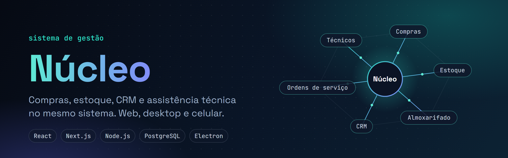
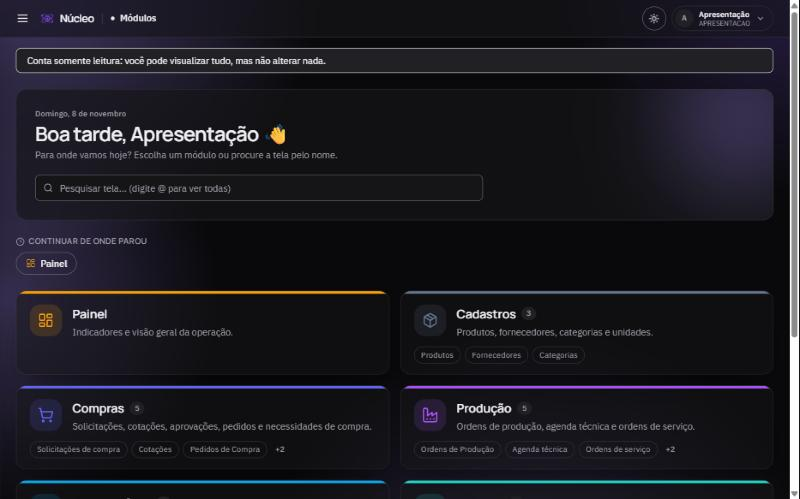
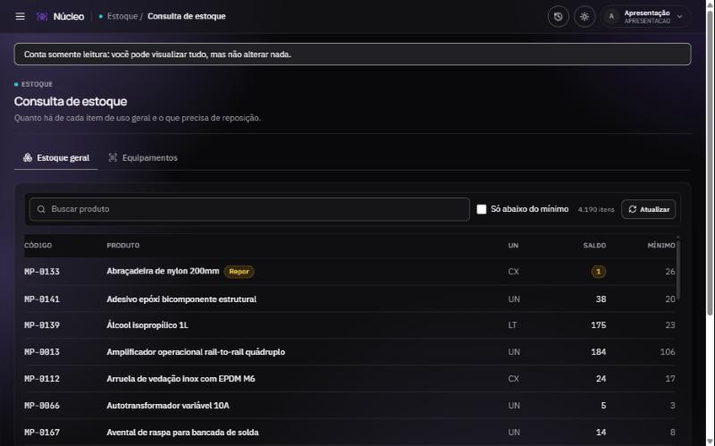
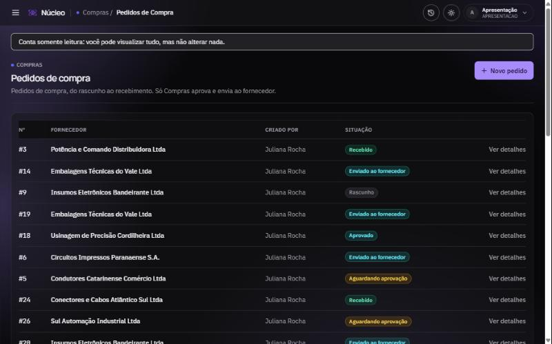
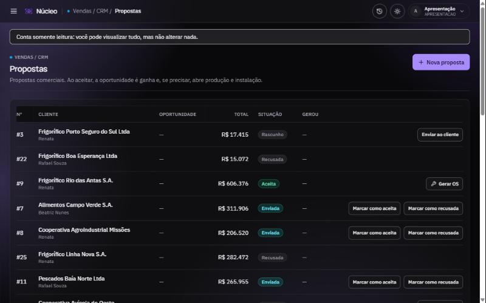
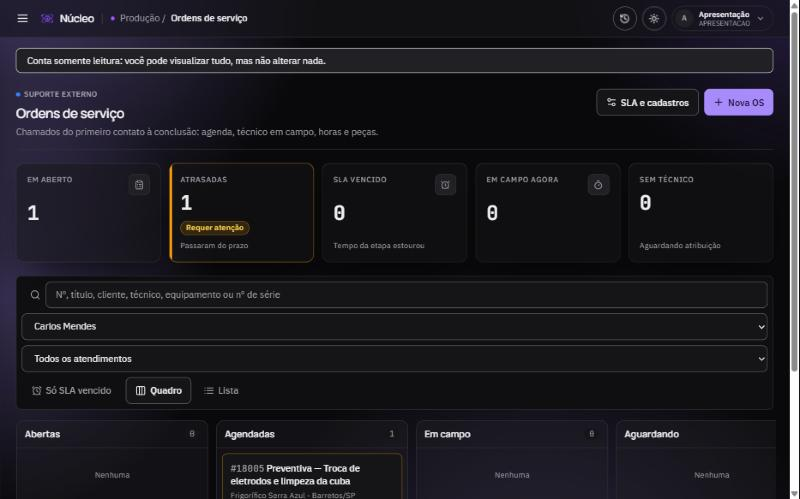
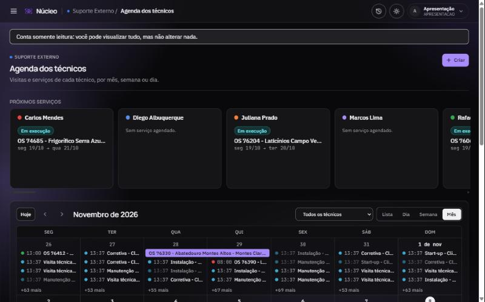

# Núcleo

Sistema de gestão para empresas de equipamentos e assistência técnica.

O código é privado, então este repositório é só pra mostrar o que o sistema faz e como ele foi montado. Se quiser ver funcionando, me chama que eu mostro.

## Por que eu fiz

Numa empresa desse tipo, cada setor costuma ter o seu jeito de controlar as coisas: compras numa planilha, estoque em outra, ordem de serviço no papel, agenda dos técnicos no WhatsApp. O Núcleo junta tudo isso num lugar só, com uma tela para cada setor.

## O que ele faz

Na parte de gestão:

- compras, almoxarifado e estoque
- cadastro de clientes (CRM)
- acesso separado por setor: admin, compras, almoxarifado, estoque, vendas e marketing
- importação de produtos e fornecedores por CSV, pra quem está vindo de outro sistema. Dá pra reimportar sem duplicar nada.

Na parte de assistência técnica:

- agenda e cadastro dos técnicos
- equipamentos com número de série e o histórico de cada um (empréstimo, locação, demonstração, devolução)
- ordens de serviço ligadas ao técnico, ao cliente e ao equipamento
- checklists preenchidos dentro da ordem de serviço
- registro de quem fez o quê, relatórios e exportação para CSV

## Como é montado

Um servidor central com a API, e três jeitos de acessar:

```
                 servidor central
          (Node + Express + Prisma + Postgres)
                         |
        +----------------+----------------+
        |                |                |
   navegador          desktop          celular
   (Next.js)         (Electron)    (Android/Capacitor)
```

Todo mundo usa a mesma API, então o que alguém lança no celular aparece na hora para quem está no computador. O login é por JWT e cada usuário só vê as telas do seu setor. Dá pra trocar o endereço do servidor pela tela de configurações, sem reinstalar o programa.

## Stack

TypeScript, React, Next.js, Tailwind, Node.js, Express, Prisma, PostgreSQL, Electron, Capacitor, Docker e Vitest nos testes.

## Telas

Prints do ambiente de apresentação. Os clientes, fornecedores e técnicos são fictícios.

<table>
<tr>
<td width="50%"><br><sub>Tela inicial, com os módulos</sub></td>
<td width="50%"><br><sub>Consulta de estoque</sub></td>
</tr>
<tr>
<td width="50%"><br><sub>Pedidos de compra</sub></td>
<td width="50%"><br><sub>Propostas do CRM</sub></td>
</tr>
<tr>
<td width="50%"><br><sub>Ordens de serviço</sub></td>
<td width="50%"><br><sub>Agenda dos técnicos</sub></td>
</tr>
</table>

---

Feito por Eduardo Perin · [LinkedIn](https://www.linkedin.com/in/eduardo-perin-95ba4a212/)
